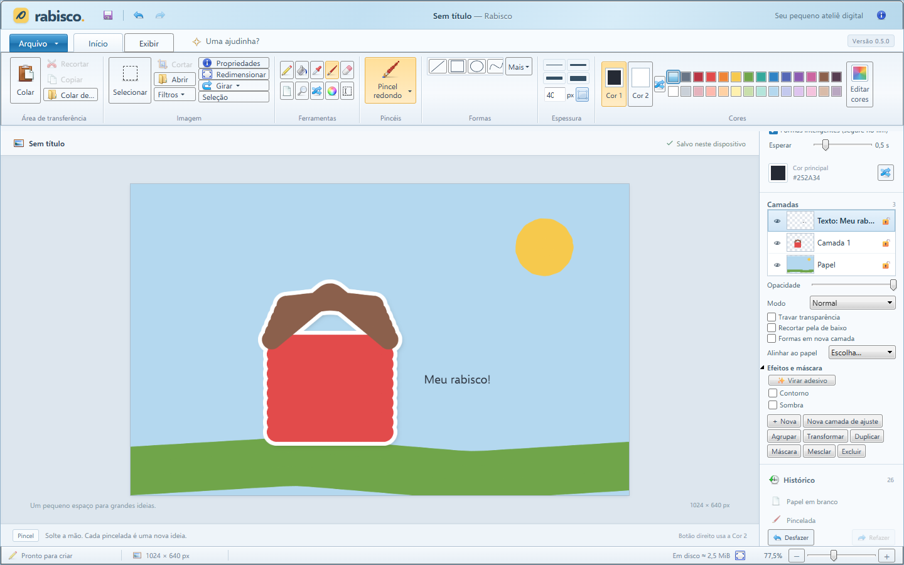
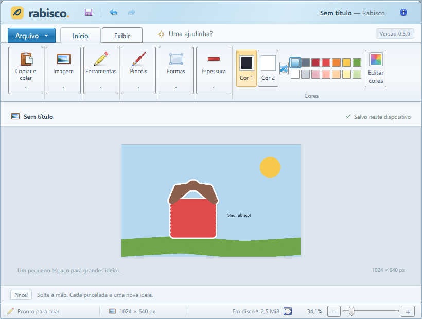

<div align="center">


# rabisco.

**O paint de sempre, com uma IA no pincel.**

Um editor de desenho no navegador com a simplicidade e a cara do paint da era Windows 7,
mais camadas, colagens e, em breve, uma IA que gera imagens com as próprias ferramentas do app
e ensina a desenhar.




</div>

---

## ✨ O que já dá para fazer

<table>
<tr>
<td width="50%" valign="top">

### 🖌️ O paint clássico, mais fácil

- Lápis, borracha, balde, conta-gotas, lupa e texto
- **9 pincéis**: redondo, duas caligrafias, aerógrafo (spray que continua borrifando parado), óleo, giz de cera, marcador, lápis natural e aquarela, com pressão de caneta
- **37 formas** (setas, estrelas, balões, coração, polígonos de N lados…) que continuam editáveis até confirmar
- **Crie suas próprias formas** e guarde como predefinição
- Seleção retangular e laço, seleção transparente, Cor 1/Cor 2 no botão esquerdo e direito

</td>
<td width="50%" valign="top">

### 🗂️ Camadas e colagens

- Camadas com opacidade, **16 modos de mesclagem**, bloqueios, máscaras e recorte
- **Contorno e sombra** que dá para editar depois, e o botão **✨ Virar adesivo**
- Cole ou arraste imagens: cada uma vira uma camada
- **Mover**, **transformação livre** (escalar, girar, distorcer) e **guias de encaixe**
- **Grupos**, alinhar ao papel e **salvar com camadas** em `.rabisco`, **PSD** e **ORA**
- Desfazer e refazer para tudo, inclusive criar, mesclar e excluir camadas

</td>
</tr>
<tr>
<td valign="top">

### 📐 Papel e arquivos

- Papel de até 8192 px, que cresce pelas alças, como no paint
- Girar, inverter, redimensionar e inclinar
- Abre e salva **.rabisco** (com tudo), **PSD** (Photoshop/Photopea) e **ORA** (Krita, GIMP)
- Imagens: abre PNG, JPEG, BMP, GIF, WebP e ICO; exporta PNG, JPEG, BMP, GIF e WebP
- Arquivos recentes no menu Arquivo
- Imprimir, réguas, grade, zoom de 12,5% a 800% e tela inteira

</td>
<td valign="top">

### 💾 Local e rápido

- **Autosave** em blocos: grava só o que mudou, sem travar
- Funciona sem internet depois de carregado; nada sai do seu computador
- Ribbon que se adapta a qualquer largura, de 800 px a 1920 px
- Abre com 186 KB de JavaScript (o React fica num arquivo próprio, em cache)

</td>
</tr>
</table>

<div align="center">

<br /><sub>Em janela estreita, os grupos do ribbon se recolhem em botões, como no paint do Windows 7.</sub>
</div>

## 🚀 Começar

Requer **Node.js 20.19+ ou 22.12+**.

```powershell
git clone https://github.com/ViniciusNoetzold/Rabisco.git
cd Rabisco
npm install
npm run dev
```

Abra o endereço que o Vite mostrar (normalmente `http://localhost:5173`).

**Ver de outro aparelho na mesma rede** (celular, tablet, outro PC):

```powershell
npm run dev -- --host 0.0.0.0
```

Use o endereço **Network** que aparece no terminal. Na primeira vez, o Windows pode pedir para liberar o Node.js no firewall.

**Versão de produção:**

```powershell
npm run build
npm run preview
```

## ⌨️ Atalhos principais

| Ferramenta         |   Tecla   |     | Ação                     | Atalho              |
| ------------------ | :-------: | --- | ------------------------ | ------------------- |
| Lápis              |    `P`    |     | Desfazer / refazer       | `Ctrl+Z` / `Ctrl+Y` |
| Pincel             |    `B`    |     | Salvar PNG               | `Ctrl+S`            |
| Spray              |    `A`    |     | Colar (camada nova)      | `Ctrl+V`            |
| Borracha           |    `E`    |     | Colar na camada atual    | `Ctrl+Shift+V`      |
| Balde              |    `F`    |     | Copiar mesclado          | `Ctrl+Shift+C`      |
| Conta-gotas        |    `I`    |     | Nova camada              | `Ctrl+Shift+N`      |
| Texto              |    `T`    |     | Duplicar camada          | `Ctrl+J`            |
| Formas             |    `U`    |     | Mesclar abaixo           | `Ctrl+Shift+M`      |
| Seleção / laço     | `S` / `L` |     | Transformação livre      | `Ctrl+T`            |
| Lupa               |    `Z`    |     | Propriedades da imagem   | `Ctrl+E`            |
| Mover camada       |    `V`    |     | Redimensionar e inclinar | `Ctrl+W`            |
| Trocar Cor 1/Cor 2 |    `X`    |     | Tela inteira             | `F11`               |

A lista completa está em **Uma ajudinha?**, dentro do app, e no [guia de uso](docs/guia-de-uso.md).

## 🗺️ Roteiro

| Versão | O quê                                                                                                                  | Situação |
| ------ | ---------------------------------------------------------------------------------------------------------------------- | :------: |
| 0.1    | Janela Aero, ferramentas básicas, PNG e autosave                                                                       |    ✅    |
| 0.2    | Todas as ferramentas do paint clássico, pincéis, spray, 37 formas, formas próprias, zoom e réguas                      |    ✅    |
| 0.2.1  | Estabilização: testes confiáveis, desempenho medido, autosave por blocos, ribbon adaptável                             |    ✅    |
| 0.3    | Camadas, máscaras, efeitos, colagem, transformação livre, `.rabisco`, PSD e ORA                                        |    ✅    |
| 0.4    | Estabilizador de traço, simetria, formas que se ajeitam sozinhas                                                       |    🔜    |
| 0.5    | Filtros e estilos: **ASCII**, pixel art, dithering, meio-tom                                                           |    🔜    |
| 0.6    | **IA com chave gratuita** (AI Horde sem cadastro, Cloudflare, Gemini, Hugging Face…) gerando e editando em camada nova |    🔜    |
| 0.7    | IA local no navegador: remover fundo, seleção inteligente, apagar objeto, ampliar                                      |    🔜    |
| 0.8    | **"Desenhe pra mim"**: a IA usa as próprias ferramentas do Rabisco, passo a passo, na sua frente                       |    🔜    |
| 0.9    | **Rabi**, o tutor que olha seu desenho, dá dicas e propõe lições                                                       |    🔜    |
| 1.0    | Instalável (PWA e desktop com Tauri), outros idiomas, acessibilidade                                                   |    🔜    |

**Para não nos perdermos:** a ideia original e os pilares estão em [docs/IDEIA.md](docs/IDEIA.md), as ferramentas e bibliotecas pesquisadas (com licença e versão em que entram) em [docs/FERRAMENTAS.md](docs/FERRAMENTAS.md), e tudo o que falta para o sistema ficar completo em [docs/MELHORIAS.md](docs/MELHORIAS.md).

Detalhes em [ROADMAP.md](ROADMAP.md), o que mudou em cada versão em [CHANGELOG.md](CHANGELOG.md) o **ponto de continuação** em [prompts/CONTINUAR_0.3.md](prompts/CONTINUAR_0.3.md) e o **plano da 0.4** em [prompts/PROMPT_0.4.md](prompts/PROMPT_0.4.md).

## 🧪 Testes e desempenho

```powershell
npm test                    # 124 testes unitários (Vitest)
npm run test:e2e            # 68 fluxos no navegador (Playwright + Edge)
npm run test:e2e:estavel    # a suíte E2E três vezes seguidas
npm run perf -- --rotulo=x  # mede pincel, spray, balde, desfazer, memória e autosave
```

Os testes de navegador usam o Edge do Windows. Em outra máquina:

```powershell
npx playwright install chromium
$env:PLAYWRIGHT_CHANNEL = 'chromium'
npm run test:e2e
```

Os resultados medidos de cada versão estão em [docs/desempenho.md](docs/desempenho.md). As imagens deste README são geradas pelo próprio app, com `node scripts/capturas.mjs`.

## 🏗️ Como é por dentro

```text
src/
  app/          Interface: janela, ribbon adaptável, painéis, diálogos e atalhos (React)
  canvas/       Coordenador do editor e superfície de desenho
    controle/   Tela e prévias, ferramentas, seleção, colagem, papel, autosave e arquivos
  commands/     Comandos em JSON, execução e histórico (pixels por área + estrutura das camadas)
  document/     Documento com camadas, compositor (modos, máscaras, efeitos) e transformações
  brushes/      Motor de pincéis por carimbo e aerógrafo
  shapes/       Catálogo de formas, editor de formas próprias e renderização
  tools/        Uma ferramenta por arquivo e o registro com os atalhos
  io/           Abrir, exportar, colar e imprimir imagens
  storage/      IndexedDB: blocos do autosave (com worker de PNG), formas e cores
tests/          unit/ (Vitest) e e2e/ (Playwright)
docs/           Ideia, ferramentas, melhorias, guia de uso, desempenho e imagens
prompts/        Prompts de cada etapa e o ponto de continuação
```

Toda edição vira um **comando JSON** (por exemplo `{ "tipo": "NovaCamada", ... }`). É isso que dá o desfazer preciso, e é a mesma porta que a IA da versão 0.8 vai usar para desenhar com as ferramentas do app.

Feito com **TypeScript, React, Vite, Zustand, Immer, Dexie e 7.css**.

## 🙏 Créditos e licença

- Interface inspirada na era Aero com o [7.css](https://github.com/khang-nd/7.css) (MIT). O Rabisco não usa ícones, fontes nem marcas da Microsoft.
- Ícones [Fugue](https://p.yusukekamiyamane.com/) de Yusuke Kamiyamane (CC BY 3.0) e fonte [Selawik](https://github.com/microsoft/Selawik) (OFL).
- O logotipo do Rabisco é original. Todos os créditos estão em [THIRD_PARTY_NOTICES.md](THIRD_PARTY_NOTICES.md) e na tela **Sobre** do app.

A licença do código do Rabisco ainda será escolhida pela pessoa responsável pelo projeto.
